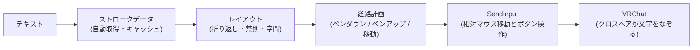

<div align="center">

<h1>AutoQV</h1>

<p>VRChatのQvPenなどのペンで、文字の筆記を自動化するWindows向けCLIツール</p>

[](https://github.com/Harukoto-Project/auto-qv/releases)
[](LICENSE)


[入手方法](#入手方法) ・ [クイックスタート](#クイックスタート) ・ [コマンド](#コマンド) ・ [書ける文字](#書ける文字) ・ [設定](#設定ファイルautoqvtoml) ・ [困ったとき](#うまく書けないとき)

</div>

---

文字のストロークデータを元に、相対マウス移動で視点を動かしてクロスヘアを文字の軌跡通りになぞらせ、マウスボタンの押下/解放でペンの上げ下げを制御して書きます。

```console
> .\autoqv.exe write "Hello こんにちは 안녕"
```

## 特長

| | |
| --- | --- |
| **多言語** | 英数字・記号・ひらがな・カタカナ・漢字・ハングルを、実際の書き順どおりに書きます |
| **インストール不要** | exeを1つ置くだけで動きます。ストロークデータは必要になったときに自動で取得し、キャッシュします |
| **書く前に確認** | `preview`で経路・大きさ・所要時間を、`check`でデータの無い文字を事前に確認できます |
| **細かく調整** | 文字の大きさ・横幅・字間・行間、マウスの感度・速度・待機時間を調整できます |
| **安全に中断** | `Alt+C`でいつでも中断でき、押していたボタンは必ず離します |

## 仕組み



## 動作環境

- Windows 10 / 11
- VRChat(QvPenなどのペンが使えるワールド。マウスで視点を操作するデスクトップモード)
- 初回の実行時はインターネット接続が必要です(ストロークデータの取得のため)

## 入手方法

[GitHubのReleases](https://github.com/Harukoto-Project/auto-qv/releases)から、最新版の`autoqv-v<バージョン>-windows-x86_64.zip`をダウンロードして展開します。単体の`autoqv-v<バージョン>-windows-x86_64.exe`も配布しています。インストールは不要です。

ソースからビルドする場合は[開発者向け](#開発者向け)を参照してください。

## クイックスタート

1. コマンドプロンプトまたはPowerShellで、`autoqv.exe`のあるフォルダを開きます
2. 次のコマンドを実行します(初回はストロークデータの取得に少し時間がかかります)

   ```powershell
   .\autoqv.exe write "Hello こんにちは"
   ```

3. 配置結果のサマリーが表示されて待機状態になります。VRChatに切り替え、ペンを持って、書き始めたい位置にクロスヘアを合わせます
4. **`Alt+P`**で書き始めます。途中で止めたいときは**`Alt+C`**を押します

> [!TIP]
> いきなり実機で書く前に、`preview`か`write --dry-run`でサマリーを確認することをおすすめします。
>
> ```powershell
> .\autoqv.exe preview "Hello こんにちは"
> ```

> [!IMPORTANT]
> VRChatが管理者権限で動作している場合は、AutoQVも管理者権限で起動する必要があります(通常権限の入力は無視されます)。

## コマンド

```powershell
.\autoqv.exe --help
.\autoqv.exe <コマンド> --help
```

| コマンド | 内容 |
| -------- | ---- |
| [`write`](#write-書く) | 書く(ホットキーの待機状態になり、実際にマウスを動かします) |
| [`preview`](#preview-経路の確認) | 経路を計算してサマリーだけを表示します。入力は送りません |
| [`check`](#check-未収録文字の確認) | テキスト中の、ストロークデータに無い文字を一覧表示します |

テキストは`<TEXT>`引数か`--file <PATH>`(UTF-8)のどちらか一方で指定します。

### `write`: 書く

```powershell
.\autoqv.exe write "HELLO"
.\autoqv.exe write --file message.txt
```

1. コマンドを実行すると(初回はストロークデータを取得してから)、配置結果のサマリーを表示して待機状態になります。この間、マウスやキーボードの入力は一切送りません
2. VRChatのウィンドウに切り替え、ペンを持って書きたい位置にクロスヘアを合わせます(書き始めの位置が文字の左上になります)
3. **`Alt+P`**で書き始めます
4. **`Alt+C`**で中断できます(待機中に押すと何も書かずに終了します)。Ctrl+Cでも中断できます

中断・終了時は、押していたマウスボタンを必ず離します。ホットキーはウィンドウのフォーカスに関係なく動作します。

`write`では、[`preview`のオプション](#オプション)に加えて次のオプションを使えます。

| オプション | 内容 | 既定値 |
| ---------- | ---- | ------ |
| `--button <BUTTON>` | ペンを下ろすために押すマウスボタン(`left` / `right` / `middle`) | left |
| `--start-hotkey <KEY>` | 書き始めるホットキー | `Alt+P` |
| `--abort-hotkey <KEY>` | 中断するホットキー | `Alt+C` |
| `--dry-run` | 入力を送らず、サマリーだけ表示して終了します | なし |

ホットキーは`Alt+P`や`Ctrl+Shift+F8`のように指定します。修飾キーは`Ctrl` / `Alt` / `Shift` / `Win`、キーは英字・数字・`F1`〜`F24`・`Esc`・`Space`・`Enter`・`Tab`です。英字・数字・`Space`・`Enter`・`Tab`は修飾キーが必須です。開始と中断には別のキーを指定してください。

<details>
<summary>未収録文字のログ</summary>

ストロークデータに無い文字はスキップし、画面に表示するとともに、ログファイルに追記します(`--dry-run`でも記録します)。ログは1行1件のJSONです。

```json
{"timestamp":"2026-10-22T00:00:00Z","char":"🙂","codepoint":"U+1F642","line":1,"column":2}
```

既定の保存先は`%APPDATA%\Harukoto Project\AutoQV\autoqv-missing-glyphs.log`です。

</details>

### `preview`: 経路の確認

指定したテキストを書いた場合の経路を計算し、サマリーだけを表示します。マウスやキーボードの入力は送りません。

```console
> .\autoqv.exe preview "Hello"
Characters placed : 5
Strokes           : 7
Extent            : 2.25 x 0.78 em
Pen down count    : 7
Moves             : 45
Draw distance     : 2382 counts
Travel distance   : 2270 counts
Estimated time    : 3.7s
```

| 項目 | 内容 |
| ---- | ---- |
| Characters placed | 配置した文字数 |
| Strokes / Pen down count | ストローク数 / ペンダウン回数 |
| Extent | 全体の大きさ(幅×高さ、単位はem) |
| Moves | 移動回数 |
| Draw distance / Travel distance | 描画距離 / ペンアップ移動距離(マウスカウント) |
| Estimated time | 推定所要時間 |

ストロークデータに無かった文字は、行・列つきで表示します(最大20件)。

#### オプション

**入力とデータ**

| オプション | 内容 | 既定値 |
| ---------- | ---- | ------ |
| `--config <PATH>` | [設定ファイル](#設定ファイルautoqvtoml) | 実行ファイルと同じ場所の`autoqv.toml`(あれば) |
| `--glyph-file <PATH>` | ストロークデータのJSONファイル。自動取得したデータに重ねて使います。複数指定でき、後のものが優先されます | なし |
| `--offline` | ストロークデータをダウンロードせず、キャッシュと`--glyph-file`だけを使います | 無効 |

**文字のレイアウト**

| オプション | 内容 | 既定値 |
| ---------- | ---- | ------ |
| `--size <N>` | 文字の大きさ(フォントサイズ)の倍率。縦横とも拡大・縮小します | 1.0 |
| `--width-scale <N>` | 文字の横幅の倍率(`--size`に対する相対値)。`0.6`なら横幅が6割になります(平体)。文字の送り幅も同じ割合で変わり、縦の大きさと字間は変わりません | 1.0 |
| `--char-spacing <N>` | 字間(文字サイズに対する比)。負の値で詰められます(最小-1.0)。詰めすぎても、隣り合う字形の隙間は0.05em未満になりません | 0.0 |
| `--line-spacing <N>` | 行間(文字サイズに対する比) | 0.4 |
| `--line-width-em <EM>` | 1行の最大幅(em)。超えると折り返します | 20.0 |
| `--no-kinsoku` | 行頭禁則処理(句読点・閉じ括弧を行頭に置かない)を無効にします | 有効 |

> [!NOTE]
> 既定の字間0でも、字形の左右に約0.125emの余白があるため、隣り合う字形の間は約0.25emあきます。詰めたいときは`--char-spacing -0.1`前後を試してください。

**マウスの感度**

| オプション | 内容 | 既定値 |
| ---------- | ---- | ------ |
| `--counts-per-em <N>` | 1emあたりのマウスカウント数(縦横共通) | 400 |
| `--counts-per-em-x <N>` / `--counts-per-em-y <N>` | 軸ごとのカウント数(`--counts-per-em`より優先) | 400 |

**速度と待機時間**

| オプション | 内容 | 既定値 |
| ---------- | ---- | ------ |
| `--step-delay-ms <MS>` | マウス移動1ステップごとの待機時間 | 4 |
| `--max-counts-per-step <N>` | 描画中の1ステップあたりの最大カウント数 | 4 |
| `--move-speed-multiplier <N>` | ペンを上げて移動するときのステップ量の倍率 | 3.0 |
| `--min-pen-down-interval-ms <MS>` | ペンダウン(ボタン押下)から次のペンダウンまでの最短間隔。`0`で無効 | 230 |
| `--pen-down-settle-ms <MS>` | 視点の移動が終わってから、ペンダウン(ボタン押下)するまでの待機時間。`0`で無効 | 30 |
| `--pen-down-delay-ms <MS>` | ペンダウン(ボタン押下)の直後、描画の移動を始めるまでの待機時間。`0`で無効 | 30 |
| `--pen-up-delay-ms <MS>` | ペンアップ(ボタン解放)の直後、次の移動を始めるまでの待機時間。`0`で無効 | 30 |

数値は、サイズ・感度・速度・待機時間が正の値、行間・ペンダウン間隔が0以上の値、字間が-1.0以上の値のみ指定できます。ペンダウン間隔と、ペンダウン・ペンアップ前後の待機時間は、`0`を指定して無効にもできます。

<details>
<summary>文字の大きさと感度の調整</summary>

`--size`は文字の大きさの倍率で、`--counts-per-em`は「1em(文字の高さの基準)を書くのに送るマウスカウント数」です。実際にワールド上に書かれる大きさは、VRChatのマウス感度と視点の距離によって決まるため、短い文字で試しながら調整してください。縦横で比率が合わないときは、`--counts-per-em-x`と`--counts-per-em-y`に別の値を指定します。

</details>

<details>
<summary>ペンダウン間隔と消しゴムモード</summary>

QvPenは、短い間隔(0.2秒未満)で近い位置を続けて押すとダブルクリックとみなし、ペンと消しゴムを切り替えます。`口`や`日`のように前のストロークの近くから次のストロークを書き始める文字で誤って消しゴムに切り替わらないよう、AutoQVは直前のペンダウンから`--min-pen-down-interval-ms`経過するまで次のペンダウンを待ちます(位置にかかわらず常に待ちます)。既定値230msはQvPenの判定時間に余裕を加えた値です。ペンの種類やワールドの設定が異なる場合は調整してください。

</details>

<details>
<summary>ペンの押下・解放後の待機</summary>

VRChatはボタンの押下・解放を1〜数フレーム遅れて処理します。待ち時間が無いと、ボタンを離した直後の移動が「まだ書いている」状態で行われ、文字と文字の間(や画と画の間)に線が引かれたり、書き始めの位置がずれたりします。AutoQVはボタンを離した後に`--pen-up-delay-ms`、押した後に`--pen-down-delay-ms`だけ待ってから次の移動を送ります。また、視点の移動が反映される前にボタンを押さないよう、押す直前に`--pen-down-settle-ms`だけ待ちます。推定所要時間にもこれらが反映されます。

</details>

### `check`: 未収録文字の確認

テキスト中の、ストロークデータに無い文字を一覧表示します。経路の計算や入力の送信は行いません。

```console
> .\autoqv.exe check "A🙂🙂"
Characters checked : 3
With stroke data   : 1
Missing glyphs     : 2 (1 unique)
  '🙂' (U+1F642) x2
```

- 未収録の文字は重複をまとめ、初めて現れた順に「文字・コードポイント・出現回数」で表示します
- 未収録の文字があっても終了コードは0です。未収録文字のログファイルには記録しません
- `--file <PATH>`でファイルからも読めます。`--glyph-file`と`--offline`も使えます(意味は`preview`と同じ)
- ストロークデータが必要なため、`write` / `preview`と同様に不足分は自動取得します

## 書ける文字

| 種類 | 範囲 | データ |
| ---- | ---- | ------ |
| 英数字・記号 | 半角の英数字・記号・スペース(ASCII) | Hershey Roman Simplex |
| ひらがな・カタカナ | ひらがな・カタカナ・`ー`・`・`・`ゝ`・`ヽ`など | KanjiVG |
| 漢字 | CJK統合漢字・互換漢字・拡張A〜F・`々`・`〆`・`、`・`。` | KanjiVG |
| ハングル | ハングル音節(가〜힣)・互換字母(ㄱ〜ㅣ) | KOSDIC Hangul single-line font |

全角の英数字・記号(`Ａ`・`「`・`！`など)や絵文字は収録されていません。必要な場合は、[`--glyph-file`](#ストロークデータを自分で用意する--glyph-file)で自分のデータを追加できます。収録されているかどうかは`check`で確認できます。

ひらがな・カタカナ・漢字・ハングルは字形に合わせた送り幅で並べるため、英字と混ぜても字間が極端に広がることはありません。

### ストロークデータの自動取得

`write` / `preview` / `check`は、起動時にストロークデータが揃っているかを確認し、足りないときだけダウンロードします。

| データ | 取得のタイミング |
| ------ | ---------------- |
| 英数字・記号(Hershey) | 初回に1回だけ |
| ひらがな・カタカナ(KanjiVG) | 初回に1回だけ(約180文字ぶん。数十秒かかることがあります) |
| 漢字(KanjiVG) | 書く文章に含まれていて、まだ取得していない文字だけをその都度 |
| ハングル | 文章にハングルが含まれているときに、フォント全体を1ファイルでまとめて1回だけ |

- 取得したデータは`%APPDATA%\Harukoto Project\AutoQV`にキャッシュされます。取得済みの文字だけで書く場合、2回目以降はネットワークに接続せずに動作します
- 取得元は特定のコミットに固定されており、Hershey・ハングルのダウンロードしたファイルはチェックサムで検証します
- KanjiVGに無い漢字(一部の異体字など)は未収録の文字として扱われ、次回以降も取得を試みません
- `--offline`を付けると、ダウンロードを一切行いません。キャッシュが無い場合は、`--glyph-file`で指定したデータだけを使います

> [!WARNING]
> 英数字・記号・ひらがな・カタカナの取得に失敗した場合は、エラーで終了します。ネットワークを確認するか、`--glyph-file`でデータを指定してください。取得済みの分は保存されるので、再実行すると続きから取得します。
>
> 漢字・ハングルの取得に失敗した場合は、警告を表示してその文字を未収録として扱い、続行します。

## 設定ファイル(`autoqv.toml`)

感度・速度・レイアウトなどをTOMLファイルに保存できます。`autoqv.exe`と同じ場所に`autoqv.toml`を置くと自動で読み込まれます。別の場所のファイルは`--config <PATH>`で指定します(指定したファイルが無い場合はエラーになります)。

すべての項目は省略できます。省略した項目は既定値になります。優先順位は次のとおりです。

**コマンドラインオプション > 設定ファイル > 既定値**

<details>
<summary>設定ファイルの例(すべて既定値)</summary>

```toml
[sensitivity]
counts_per_em_x = 400.0
counts_per_em_y = 400.0

[pen]
button = "left"
step_delay_ms = 4
max_counts_per_step = 4
move_speed_multiplier = 3.0
min_pen_down_interval_ms = 230
pen_down_settle_ms = 30
pen_down_delay_ms = 30
pen_up_delay_ms = 30

[layout]
size = 1.0
width_scale = 1.0
char_spacing = 0.0
line_spacing = 0.4
line_width_em = 20.0
kinsoku = true

[log]
missing_glyph_log = "autoqv-missing-glyphs.log"

[safety]
start_hotkey = "Alt+P"
abort_hotkey = "Alt+C"
```

</details>

- 知らないキーやセクション名はエラーになります(タイプミスで設定が無視されないようにするためです)
- `missing_glyph_log`の相対パスは`%APPDATA%\Harukoto Project\AutoQV`が基準です。絶対パスも指定できます

## うまく書けないとき

| 症状 | 対処 |
| ---- | ---- |
| 文字と文字の間、画と画の間に線がつながる | `--pen-up-delay-ms`を増やします |
| 書き始めが欠ける・ずれる | `--pen-down-delay-ms`と`--pen-down-settle-ms`を増やします |
| 書いている途中で消しゴムに切り替わる | `--min-pen-down-interval-ms`を増やします |
| 文字が大きすぎる・小さすぎる | `--counts-per-em`か`--size`を調整します |
| 縦横の比率がおかしい | `--counts-per-em-x`と`--counts-per-em-y`を調整するか、`--width-scale`を使います |
| 字間が広い・狭い | `--char-spacing`を調整します(負の値で詰まります) |
| 思ったより時間がかかる・形が崩れる | `--step-delay-ms`と`--max-counts-per-step`を調整します。速すぎると形が崩れ、遅すぎると時間がかかります |
| 一部の文字が書かれない | `check`で未収録文字を確認します。`--glyph-file`でデータを追加できます |

## ストロークデータを自分で用意する(`--glyph-file`)

次の形式のJSONファイルを`--glyph-file`で指定すると、自動取得したデータに重ねて使えます(同じ文字があればこちらが優先されます)。自動取得に含まれない文字(全角記号など)を書きたいときや、オフラインで使うときに利用します。

```json
{
  "version": 1,
  "glyphs": {
    "I": {
      "advance": 0.5,
      "strokes": [[[0.25, 0.1], [0.25, 0.9]]]
    },
    "L": {
      "advance": 0.6,
      "strokes": [[[0.2, 0.1], [0.2, 0.9], [0.5, 0.9]]]
    }
  }
}
```

- 座標は0.0〜1.0の正方形(原点は左上、yは下向き)で表します
- `strokes`は「ストロークの配列 → 点の配列 → `[x, y]`」です
- `advance`は次の文字までの送り幅で、0より大きい値にします
- キーは1文字だけにします

## 注意

> [!CAUTION]
> - 書き始めの位置は、待機中に合わせたクロスヘアの位置です。書き始める前に、ペンの位置と書き込める範囲を確認してください
> - 書いている間は、マウスを動かしたりウィンドウを切り替えたりしないでください。位置がずれたり、別のウィンドウに入力が送られたりします
> - コンソールウィンドウを閉じて終了すると、ボタンが押されたままになる場合があります。終了は`Alt+C`かCtrl+Cを使ってください
> - 使用するワールドやVRChatの利用規約・ルールに従ってください

## 開発者向け

### 前提

- Rust(edition 2024に対応した安定版)
- Windows(`SendInput`と`RegisterHotKey`を使用するため、Windows以外では動作しません)

### ビルドと確認

```powershell
cargo build --release
cargo fmt
cargo clippy --all-targets
cargo test
```

ビルドしたexeは`target\release\autoqv.exe`に出力されます。開発中は`cargo run -- preview "Hello"`で直接実行することもできます。

### ディレクトリ構成

```
src/
├─ cli/         コマンドライン引数とサブコマンド
├─ config/      設定ファイルの読み込みと検証
├─ dataset/     ストロークデータの取得・変換・キャッシュ
├─ glyph/       ストロークデータのモデルと読み込み
├─ layout/      テキスト → 配置済みストローク(折り返し・禁則)
├─ missing_log/ 未収録文字のログ出力
├─ planner/     配置済みストローク → 操作列(PenDown / PenUp / Move)
├─ input/       入力デバイス(SendInput・ホットキー・dry-run)
└─ runner/      操作列の実行(ステップ分割・待機・中断)
```

### リリース

`Cargo.toml`の`version`を更新して`v<version>`のタグをpushすると、GitHub Actionsがclippyとテストを実行したうえで、リリースビルドのzipとexeをGitHub Releaseに添付します。タグと`Cargo.toml`のバージョンが一致しないと失敗します。

### デバッグ方法

<details>
<summary>経路をマウスを動かさずに確認する</summary>

`preview`は入力を送らないため、レイアウトや経路計画の確認に使えます。折り返し・禁則・感度を変えたときの値の変化を、次のように比較できます。

```powershell
cargo run -- preview "Hello, World" --counts-per-em 300
cargo run -- preview "Hello, World" --line-width-em 5 --no-kinsoku
```

データに無い文字は「未収録」として行・列つきで表示されるので、データ不足の確認にも使えます。ストロークデータの自動取得を試したくないときは、`--offline`と`--glyph-file`を組み合わせると、ネットワークに接続せずに確認できます。

`write --dry-run`は`preview`と同じサマリーを表示しますが、未収録文字をログファイルに記録する点が異なります。ログ出力の確認に使えます。

</details>

<details>
<summary>文字の幅・間隔を実測する</summary>

`preview`の`Extent`(全体の幅×高さ、単位はem)は、字間・横幅の調整や、英語と日本語を混ぜたときの見た目の確認に使えます。

```powershell
cargo run -- preview "Hello" --char-spacing -0.1
cargo run -- preview "こんにちは Hello" --offline
```

</details>

<details>
<summary>実機に入力を送らずに<code>write</code>の流れを確認する</summary>

`write`はホットキーの待機状態に入った時点では入力を送りません。VRChatなどに切り替えずに、待機中に`Alt+C`を押すと何も送らず終了するので、ホットキーの登録や待機の動作だけを確認できます。ホットキーが他のアプリと衝突する場合は`--start-hotkey` / `--abort-hotkey`で変更してください。

</details>

<details>
<summary>設定ファイルの確認</summary>

`--config`で指定した設定ファイルの内容は、`preview`の出力(推定時間・移動距離)に反映されます。エラーメッセージにはファイルのパスとキー名が含まれます。

</details>

<details>
<summary>ストロークデータのキャッシュを確認・やり直す</summary>

キャッシュ先は`%APPDATA%\Harukoto Project\AutoQV`です。

```
manifest.json                   取得元のコミット・変換バージョン・上流に無かった文字の一覧
LICENSES.txt                    取得したデータの謝辞
hershey/rowmans.json            英数字・記号
kanjivg/<コードポイント>.json   ひらがな・カタカナ・漢字(1文字1ファイル。例: あ = 03042.json)
hangul/<コードポイント>.json    ハングル(1文字1ファイル。例: ㄱ = 3131.json)
```

- 特定の文字だけ取得し直したいときは、`kanjivg`内のその文字のファイルを削除します(次回の実行で取得します)
- 「上流に無かった文字」として記録された漢字を試し直したいときは、`manifest.json`の`kanjivg.not_found`から該当のコードポイント(10進数)を削除します
- ハングルは1文字だけの取り直しはできません。`hangul`フォルダを削除すると、次回の実行でフォント全体を取得し直します
- すべてやり直したいときは、フォルダごと削除します
- 変換処理を変更したときは、コード内の変換バージョンを上げます。`manifest.json`の値と一致しないデータは、次回の実行で破棄して取得し直します
- 取得状況は、標準エラー出力に進捗として表示されます。リダイレクトした場合は1行ずつのログになります

</details>

<details>
<summary>テストの実行とバックトレース</summary>

```powershell
cargo test
cargo test executor
cargo test -- --nocapture
```

- モジュール名・テスト名の一部を指定すると、その範囲だけ実行できます(例: `layout` `planner` `hotkey` `executor`)
- `--nocapture`を付けると、テスト中の標準出力を表示します

パニック時のバックトレースを見るには、環境変数を設定します。

```powershell
$env:RUST_BACKTRACE = "1"
cargo test
```

</details>

<details>
<summary>テストしやすい構造</summary>

- `glyph` / `layout` / `planner` / `runner::timing` / `input::hotkey`は純粋なロジックで、入力デバイスなしでテストできます
- `runner::executor::execute`は`PenDriver` traitを受け取るため、実機の代わりにテスト用のドライバ(`executor.rs`のテスト内の`FakeDriver`)で、分割・中断・ボタン解放の動作を確認できます
- 入力を送らず集計だけする`DryRunDriver`(`input/dry_run.rs`)は`preview`で使っています
- `dataset`の取得処理は`Fetcher` traitを受け取るため、ネットワークに接続せずにテストできます

</details>

<details>
<summary>マウスボタンが押されたままになった場合</summary>

実機での動作確認中にプロセスを強制終了すると、ペンのボタンが押されたままになることがあります。マウスを1回クリックすると解除できます。通常の終了・中断・panic・Ctrl+Cでは自動的に解放されます(コンソールウィンドウを閉じた場合を除く)。

</details>

<details>
<summary>ホットキーが登録できない場合</summary>

`failed to register hotkey ... it may be in use by another application`と表示されたときは、他のアプリが同じキーの組み合わせを使っています。`--start-hotkey` / `--abort-hotkey`か設定ファイルの`[safety]`で、別のキーの組み合わせに変更してください。

</details>

## ライセンスとデータの出典

本ツールのソースコードは[Apache License 2.0](LICENSE)です。

ストロークデータは本リポジトリにもexeにも含まれません。次のデータを実行時に取得して利用します(変換後のデータはキャッシュ先に保存され、謝辞は同じ場所の`LICENSES.txt`に書き出されます)。

| データ | 用途 | 作者・ライセンス |
| ------ | ---- | ---------------- |
| [Hershey Fonts](https://github.com/kamalmostafa/hershey-fonts)(Roman Simplex) | 英数字・記号 | A. V. Hershey博士とJames Hurt氏による |
| [KanjiVG](https://github.com/KanjiVG/kanjivg) | ひらがな・カタカナ・漢字 | Ulrich Apel氏による。CC BY-SA 3.0。変換後のデータも同じライセンスです |
| [KOSDIC Hangul single-line font](https://github.com/golanlevin/p5-single-line-font-resources)(KOSDICHS) | ハングル | Choi Samrak氏による原作フォントを、SVGフォントに変換したものを利用します。KOSDICのベクターフォントは、韓国建設技術研究院が制限なく利用できるとして公開しています |
